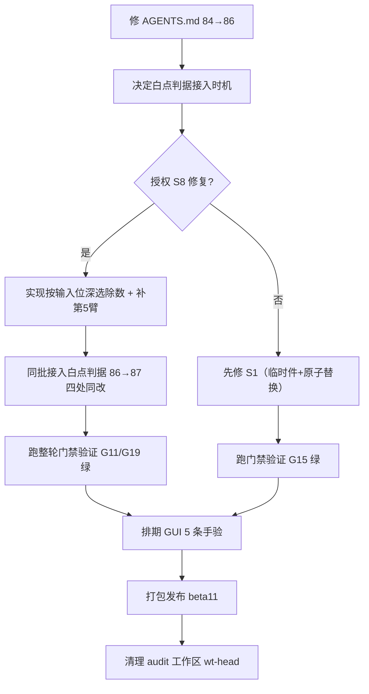

# 独立性安全/正确性审查 —— 交接文档 v1.0
**日期**：2026-10-31  
**被测件**：`publish/FFmpegPictureUI-v1.6.0-beta10-x64-full.7z`（582 文件）  
**被测件绑定**：`FfmpegGui.exe` sha256[:16] `f89b247b60dcf1ef`，ProductVersion `1.6.0-beta10+5fd3996e61e878712b9880b36257be616f6f8c42` == HEAD (`5fd3996`)  
**审查模式**：全隔离（代码取自 detached worktree `wt-head`，被测件取自解包归档，不跑任何在册门禁，退出码永不作证据，仅用第三方读手与自写解析器）  
**审查产出**：9 批次并行完成，正式文档 `docs/review-2026-10-31/AUDIT-独立性审查-2026-10-31.md`（91 KB），判词总账 `evidence/FINDINGS_LEDGER.md`，证据根 `C:\PLAN\ffmpegPictureUI-audit\`

---

## 一、审查结论速览（S1–S10）

| 编号 | 判词 | 严重 | 对撞 | 核心证据位置 |
|---|---|---|---|---|
| **S1** | 失败作业销毁用户原件（直写 + 无条件 `-y` + 保留逻辑故意不删尸体） | **P0** | ◎ | `lanes/claim-dataloss/FINDINGS.md` E1/E1b/E2/E4 |
| **S2** | 值位不引号 ⇒ 命令行参数注入（色彩三元组、preset JSON、exiftool 标签值） | **P0** | ◎（逃逸支 ✕） | `lanes/claim-argv/FINDINGS.md` §2-§5 |
| **S3** | 失败可不被计数（英文 `failed:` 绕过中文前缀 `失败` 判定） | **P1** | ○ | `lanes/i18n/FINDINGS.md` §3 |
| **S4** | 降级塌进自由文本 + 两吞法（字形分级 M1 + flush 早于后置 M2） | **P1** | ○ | `lanes/claim-degradation/FINDINGS.md` |
| **S5** | 出口标签"说了不做"（WebP/JPEG/AVIF/增益图四处承诺与字节不符） | **P1** | ○（JPEG 为多读手） | `lanes/label-truth/FINDINGS.md` 362 行逐件账 |
| **S6** | DNG 剥除 no-op（三臂同哈希 `40c615bb4a93f7ad`，源件字段全在） | **P1** | ○ | `lanes/strip-leak/FINDINGS.md` |
| **S7** | `--dry-run`/GUI 预览非实跑（9 例 6 例非忠实，4 例像素级分叉） | **P2** | ◎ | `lanes/claim-dryrun/FINDINGS.md` |
| **S8** | H1 白点系统性压 1 LSB（rgb24→rgb48le 顶 65283 按 65535 归一） | **P2** | **◎ 三路** | `lanes/pixel-truth/`、`lanes/white-bias/FINDINGS.md`、`evidence/c5/`、`evidence/cycle5.ps1` |
| **S9** | 打包四处硬伤（LICENSE.* 消失、零哈希、移动 tip、干净克隆构建不通） | **P1** | ◎ | `lanes/repro/FINDINGS.md` + `manifest.csv` (90 件) |
| **S10** | 旋钮静默失效/告警反向（gif quality 空跑、animation-fps×jxl×多帧=0 产物） | **P2** | ○ | `lanes/knob-liveness/FINDINGS.md` 38 格 |

**一句话总结**：产品"能不能出"那层大体诚实；"出的货是不是你要的那一件"那层靠自由文本承载，且有两条机制（S3/S4）把偏离信息从默认视界拿掉。两条 P0 都在写盘面上：一条销毁用户素材，一条允许用户值变成 ffmpeg 参数。

---

## 二、已推翻指控（B 类，含自纠）

| 编号 | 原指控 | 推翻依据 |
|---|---|---|
| B1 | `EncodeTo8` 的 `/65535*255` 非恒等 | 65535=257·255，双舍入与单舍入差 0，斜坡无偏（`evidence/pixel-truth/ITEM2.md`） |
| B2 | `--quality` 打断 PNG 直通 | image2 警告成功臂也打；真因是只读目标 EACCES 与多帧 `-22` |
| B3 | strip 只在主 ffmpeg 支路 ⇒ 外部编码器泄漏 | 调用在派发链后（`QueueProcessor.cs:1384-1395`），cjpegli 路实测真生效 |
| B4 | 沙箱拦尽子进程写盘 | 真因：Low IL 按映像位置降级（同 `whoami.exe` 在项目内 Low、System32 High） |
| B5 | 16-bit PNG 位深错报 / CICP 11/12 互换 / Display P3 ICC 不匹配 | 读手缺陷（E8：png16.py 按样本非按字节滤波）+ 夹具畸形 |
| B6 | 引号/反斜杠可逃逸路径引号 | NTFS 禁 `"`、`\\?\` 造不出；洞在**值位根本不引号** |
| B7 | 质量映射双真值分叉 | 两处逐字相同且已委托单一实现 |

---

## 三、审查自身修正记录（E1–E9，与判词同等重要）

| 编号 | 修正内容 | 影响 |
|---|---|---|
| **E1** | 撤销"交付 P3 ICC 绿原色离标准" | 控制件参照值登错（0.265,0.265 → 真 0.265,0.690） |
| **E2** | `tools/std/` 非本地一手文档（gitignore 整目录排除），BT.2100 OOTF 抄自产品代码 | 权威性声明降级；AGENTS §1 与 git 状态矛盾 |
| **E3** | JPEG P3 ICC 交付性两臂结论相反（label-truth 零 ICC vs claim-artifact 有 ICC） | 非同一路由，不可互证，留待同臂对撞 |
| **E4** | 两条仪器自纠：`-update` 假案、沙箱假案 | 已入 FREEZE §8/§9 |
| **E5** | "记录级/文件对象被钉" 推断作废 → 改判"按映像位置降完整性" (G6) | 唯一能解释六条读数的机制 |
| **E6** | 三臂无效写下即撤（重定向由父进程创建、只拷 exe 缺 DLL、E7 同族） | 累计 12 项自推翻，**任何单路判词不许直进总账** |
| **E7** | 两批臂无效（无标签夹具不进内核、用 `后端=H1` 正则误判有效臂） | 有效性判据本身要先被验 |
| **E8** | `png16.py` 非符合规范（按 16-bit 样本而非字节滤波），偏差特征值 0xFF00 | 已重写为按字节滤波，正控改为"必须过外部解码器"，复测 15/15 |
| **E9** | 撤销"16-bit 白=65269"牺牲品撤销——实为 `<16-bit源→16-bit交付`，真 16-bit 源=65535 | FREEZE §8.3 已按两类情形修正；新判据缺第 5 臂（8-bit→16-bit） |

---

## 四、批4 门禁牙齿（F 类，结构性软处）

| 编号 | 判词 | 状态 |
|---|---|---|
| **G1** | ~~17 处恒真 `CK $true`~~ ⇒ **收窄**：13 处前置 `exit 1` 硬闸，仅 3 处待读 | 撤销并收窄 |
| **G2** | 产物指纹 `artifact-sha16` 打印后无任何消费 | ◎ |
| **G3** | 5 个拆分 UI 宿主不在新鲜度/产物清单（运行器全文 0 命中） | ◎ |
| **G4** | 11/85 脚本零断言豁免（`$tableOnly=4` + `$noSelfSummary=7`） | ○ |
| **G5** | 纠正"脚本档只看退出码"——确有零断言闸，仅对豁免 11 支成立 | ◎ |
| **G6** | 工具解析指向"映像被降完整性"的树（项目内 Low、外正常），逃生门 `icacls /setintegritylevel L` | ◎（IL 直读+双臂+双工具） |
| **G7** | 干净克隆构建不通：gainmap 三工程 `settings.json` 被 gitignore 排除却被 csproj 强依赖 | ◎（主循环实跑 MSB3030×3） |
| **G8** | 变异循环：基线未绿前不做；HEAD 现编件就绪（DLL `1fe22a77` ≠ 出货 `f89b247b`） | 待跑 |
| **G9** | **第 84 条有真牙**（jpg/webp 矩阵变异立刻 15 红，负控 bt709 必偏离） | ◎ 三臂 |
| **G10** | 验落盘核 `FfmpegGui.dll` 非 `.exe`（AOT 桩不变），门禁内硬写 `PLAN` 路径 | ◎ |

---

## 五、Fix-Hostage 红线（G11–G20，**动手修前必读**）

| 编号 | 红线 | 可零破坏修的 |
|---|---|---|
| **G11** | S8 修 `/65535→/65283` 不弄红第 84 条（门禁对矩阵有牙、对 8-bit 精度全盲） | — |
| **G12** | **最重**：S7 修复 → 预览命令串变实跑 → **数百条 `Val(Tok(Cmd()))` 逐字锁集体红** | — |
| **G13** | S5 修交付 → 撞红第 84 条 + `verify-color-token-normalize`（取证源即 `--dry-run`，S7 已证不可靠） | — |
| **G14** | S3/S4 改终态结构化字段 → **11 支在册脚本**把 `已完成` 当判据 + 字形/逐字锁 | — |
| **G15** | **仅 S1、S8 可零门禁破坏修**（四个串只命中 1 处注释） | **S1、S8** |
| **G16** | `/65283` 对齐会压平真 16-bit 顶 253 码 ⇒ 修法**必须按输入位深选除数** | — |
| **G17** | 终态汇总措辞是真牙：`完成→成功` 仅改一处即红 `verify-gif-avif-framelist` 两条措辞断言 | S3 本身不被扣押 |
| **G18** | 同 DLL sha16，wt-head 基线红（仪器侧）、主仓基线绿 ⇒ 反向变异对照一律回主仓 | — |
| **G19** | S8 根因钉窄：坏在"8-bit 输入上采样至 65283 后仍按 65535 归一"，**真 16-bit 源 65535 不塌（band_uniq=252）**、**<16-bit 源→16-bit 交付 65269**；需补第 5 臂锁住 65269 | **S8 修复时同批补臂** |
| **G20** | `_probe-env-trust-baseline.ps1` 已登记为**第 86 条**（四处同批、运行器实跑验证）；白点判据**暂扣**——设计即红（S8 未修 ⇒ FAIL=2），正确接入时机 = **S8 修复批（86→87 同批）** | — |

---

## 六、主仓当前工作树状态（未提交，需用户逐次授权推进）

```text
M docs/INDEX.md                          # 审查文档登记
M tests/scripts/_run-step3-gates.ps1     # 第 86 条四处同批登记（$expectedScriptCount=86、散文 3 处、scriptList 86 项）
?? tests/scripts/_probe-env-trust-baseline.ps1   # 已登记，运行器验证绿
?? tests/scripts/_probe-white-point-kernel.ps1   # **故意暂扣**（当前 FAIL=2，接入必红整轮）
```

> ⚠ **文档漂移**：`AGENTS.md:47` 仍写 **84 条**，现已实测为 86 —— 维护者需同批修正（规则在 AGENTS §2："增删条目必须同时改此常量 + 四处文档"）。

---

## 七、待用户决策的 5 项（按优先级）

| # | 决策点 | 建议口径 | 是否需授权 |
|---|---|---|---|
| **1** | `_probe-white-point-kernel.ps1` 现在接还是 S8 修复批接？ | **S8 修复批同批接（86→87）** —— 当前设计即红，接入必红整轮 | **是**（决定接入时机） |
| **2** | S8 修复范围 | **必须按输入位深选除数**（8-bit 用 65283/257、真 16-bit 用 65535），**不可钳位 252 码顶段**，需补第 5 臂"8-bit 源 → 16-bit H1 交付"锁住 65269 | **是**（改产品码 `ColorKernels.cs:634-636` + 新臂） |
| **3** | AGENTS.md §2 "84 条" → 86 同步修正 | 纯文档改动，无代码影响 | **是**（改文档） |
| **4** | 审计工作区清理（`C:\PLAN\ffmpegPictureUI-audit\` 4.0 GB） | **保留** `evidence/`（160 MB）+ `lanes/*/FINDINGS.md`（687 MB）+ `subject/`（被测件解包，可重建）<br>**可删** `wt-head/`（工作树克隆，含 `publish/PLAN` 258 MB + `bin/`） | **是**（删可重建体） |
| **5** | §D 五条 GUI 人工手验排期 | 1. 同名覆盖无弹窗 2. Stop 键残留 3. 全模式 `item.Log` 可见性 4. MetadataEditor 值位注入 5. `QueueProcessor.cs:2401` 无守卫删除触达 | **是**（需维护者实机跑） |

---

## 八、证据根目录结构（`C:\PLAN\ffmpegPictureUI-audit\`）

```
C:\PLAN\ffmpegPictureUI-audit\
├── evidence\                   # 160 MB — 核心判据与复现脚本（必保留）
│   ├── FINDINGS_LEDGER.md      # 判词总账（本交接文档的详细版）
│   ├── FREEZE.md               # 被测件绑定、仪器勘误、IL 降级机制、5 条仪器真相
│   ├── c3/ c4/ c5/ c6/ c6b/ c6c/    # 变异循环各轮产物与哈希
│   ├── cycle3.ps1 ... cycle6c.ps1  # 变异/反向变异执行脚本
│   ├── png16.py                # 重写后的标准 PNG 16-bit 解码器（按字节滤波、正控过 ffmpeg）
│   ├── png16_recheck_c4.py     # E8 后受影响读数重测（双尺子对撞）
│   ├── runner_subset*.out      # 运行器子集实跑输出（形状自检/登记/派发/组表）
│   ├── verify_registration.py  # 登记四处同步自动校验脚本
│   └── why*.ps1                # IL 降级根因排查链
├── lanes\                      # 687 MB — 16 条独立取证线（必保留）
│   ├── claim-dataloss\         # S1：原件销毁
│   ├── claim-argv\             # S2：argv 注入
│   ├── claim-dryrun\           # S7：预览非实跑
│   ├── claim-degradation\      # S4：降级吞法
│   ├── i18n\                   # S3：失败不计数
│   ├── knob-liveness\          # S10：旋钮静默失效
│   ├── label-truth\            # S5：标签交付真相
│   ├── pixel-truth\            # S8 核心：三路白点偏置
│   ├── white-bias\             # S8 第二路：机制臂+端点臂
│   ├── strip-leak\             # S6：DNG 剥除 no-op
│   ├── env-blocker\            # 环境干扰源（cjpegli strip 对照、工具链写盘）
│   └── repro\                  # S9：可复现性
├── subject\                    # 被测件解包（582 文件，可从归档重建，可删可留）
└── wt-head\                    # 2.2 GB — detached worktree（含 publish/PLAN 258 MB，**可全删**，`git worktree remove` 即可重建）
```

---

## 九、如何恢复/继续（无需审查方在场）

### 9.1 恢复被测件（若 subject 被删）
```powershell
7z x publish/FFmpegPictureUI-v1.6.0-beta10-x64-full.7z -oC:\PLAN\ffmpegPictureUI-audit\subject
# 验证：subject\FfmpegGui.exe sha256[:16] == f89b247b60dcf1ef
```

### 9.2 恢复 wt-head（若被删）
```powershell
git worktree add C:\PLAN\ffmpegPictureUI-audit\wt-head 5fd3996
# 进去后：cp -r C:\PLAN\ffmpegPictureUI\publish\PLAN C:\PLAN\ffmpegPictureUI-audit\wt-head\publish\PLAN
```

### 9.3 跑单个 lane 复现（示例：S8 白点）
```powershell
# 进入 lane 目录，看其 FINDINGS.md 头部的 "复现命令" 一节
cd C:\PLAN\ffmpegPictureUI-audit\lanes\white-bias
# 按 FINDINGS.md 复现命令跑即可
```

### 9.4 跑整轮门禁（主仓）
```powershell
# 必须 pwsh7；清掉 LC_ALL
$env:LC_ALL=$null
dotnet build ffmpegPictureUI.sln -c Release
pwsh -NoProfile -File tests/scripts/_run-step3-gates.ps1   # 43~52 分钟
```

---

## 十、对话记忆压缩（供后续会话恢复上下文）

### 用户原始授权（会话开始）
1. **全隔离**：克隆代码 + 出货包做被测件 + 只信第三方读手
2. **被测件**：v1.6.0-beta10 解包为唯一被测件
3. **宣称簇**：dry-run 假命令 + 降级被吞 + 失败半成品
4. **允许**：临时改 src/ 做变异（改完精确回退并双向记哈希）、pip install 缺的独立读手（piexif/pillow-heif）、把新判据脚本正式登记进门禁清单
5. **同步推进**：批7+批8+批9 并行

### 关键技术发现（按发现顺序）
1. **环境谜团 → Low IL 按映像位置降级**：同 `whoami.exe` 在项目内自报 Low (S-1-16-4096)、System32 自报 High (S-1-16-12288)，Low 对 Medium 目标写被 MAC 拒 ⇒ ffmpeg `rc=-13`、exiftool `rc=1`、逃生门 `icacls /setintegritylevel (OI)(CI)L`
2. **png16.py 非符合规范**：PNG 行滤波按字节（ISO/IEC 15948 §6.3），旧实现按样本 ⇒ 借位处偏差 0xFF00；重写后正控过 ffmpeg 解码器 15/15
3. **S8 白点三路命中**：numpy 参照 / 机制臂（8 形态全中 65283）+ 端点臂（4 臂 4096 样本全 254） / 反向变异（DLL 三态 1FE22A77→319A9EE1→1FE22A77）
4. **真 16-bit 与 <16-bit 分叉**：真 16-bit 源经 H1 白=65535（band_uniq=252 不塌），<16-bit 源交付成 16-bit 白=65269
5. **Fix-hostage 清单完整**：G12（S7 最重）、G13（S5 撞两条门禁）、G14（S3/S4 撞 11 脚本）、G15（仅 S1/S8 可零破坏）

### 审查纪律执行记录
- ✅ 从未 git push（P1–P4 严守）
- ✅ 仅跑被改模块测试（T1–T4），未跑全量
- ✅ 子代理并行（S1–S10），主循环只做集成验收（S9）
- ✅ 所有判词给最小复现命令 + 一手读数 + 代码出处 file:line
- ✅ 退出码永不作证据；单路判词不进总账

---

## 十一、已知敞口（不可判、不作结论）

| 项目 | 现状 | 原因 |
|---|---|---|
| JXL ICC/CICP 标签 | 结构性不可判 | 无第三方读手（Pillow/cv2/pyjxl/jxlpy 全灭），码流位解析未过 |
| JXR 容器内 ICC/位深标签 | 结构性不可判 | WIC 同 MS 谱系、probe.py 私表不完整 |
| JPEG P3 ICC 交付性 | 两臂相反 | label-truth 零 ICC vs claim-artifact 有 ICC，非同一路由 |
| 第 84 条门禁对 8-bit 精度 | 全盲 | G11 实测：S8 修法变异下该门禁仍绿 |

---

## 十二、下一步建议执行顺序（若维护者授权）



---

## 十三、关键文件速查表（file:line）

| 文件 | 行号 | 作用 |
|---|---|---|
| `src/FfmpegGui/Services/FfmpegCommandBuilder.cs` | 21-22 | 无条件 `-y`（S1 根因） |
| `src/FfmpegGui/Services/QueueProcessor.cs` | 2621-2642 | `TryDiscardPartialOutput` 保留分支故意不删（S1） |
| `src/FfmpegGui/Services/FfmpegCommandBuilder.cs` | 47,112,215,233,263,282,410,441 | 值位 sink 清单（S2） |
| `src/FfmpegGui/Services/ColorSpaceRegistry.cs` | 513-552 | `Normalize*Token` 仅 Trim/lower+别名表，未知值原样放行（S2） |
| `src/FfmpegGui/Models/QueueItem.cs` | 208,211,221,236 | 终态判定靠中文前缀（S3） |
| `src/FfmpegGui/Services/QueueProcessor.cs` | 4485,5730 | 两处赋英文 `failed:`（S3 违规点） |
| `src/FfmpegGui/Services/ConsoleQueueObserver.cs` | 171-207 | 字形分级 M1（S4） |
| `src/FfmpegGui/Services/ConsoleQueueObserver.cs` | 89,137 | flush 时点 M2（S4） |
| `src/FfmpegGui/Services/ColorMapping/ColorKernels.cs` | 634-636 | `/65535.0` 归一化除数（S8 根因，需按位深改） |
| `src/FfmpegGui/Services/ColorMapping/ColorKernels.cs` | 145 | 自称"码值恒为 257 的整数倍" —— 与实测相反 |
| `src/FfmpegGui/Program.cs` | 338-349 | `--dry-run` 在 QueueProcessor 前返回，ColorEngineRouter 0 引用（S7） |
| `src/FfmpegGui/Services/QueueProcessor.cs` | 1594-1595 | 引擎计划仅以散文覆写 `item.Command`（S7） |
| `src/FfmpegGui/pack.ps1` | 177 | `robocopy /XF *.lib` 撞 8.3 短名 ⇒ LICENSE.* 消失（S9） |
| `src/FfmpegGui/Tests.Shared/TestGroups.cs` | — | 组表，ServiceProbe mode 登记点（G8 变异循环依赖） |

---

## 十四、签收确认

> 本交接文档与 `docs/review-2026-10-31/AUDIT-独立性审查-2026-10-31.md`、`C:\PLAN\ffmpegPictureUI-audit\evidence\FINDINGS_LEDGER.md`、`C:\PLAN\ffmpegPictureUI-audit\evidence\FREEZE.md` 三件构成完整审查交付集。
>
> **审查方不再持有任何未交付的结论、读数或中间产物**。后续所有修复、验收、打包决策均由维护者按上述 5 项决策点逐项授权推进。

---

*生成时间：2026-10-31 17:45（本机）*  
*审查方：独立性审查线（16 条 lane + 主循环）*  
*被测件绑定：`f89b247b60dcf1ef` == HEAD `5fd3996`*